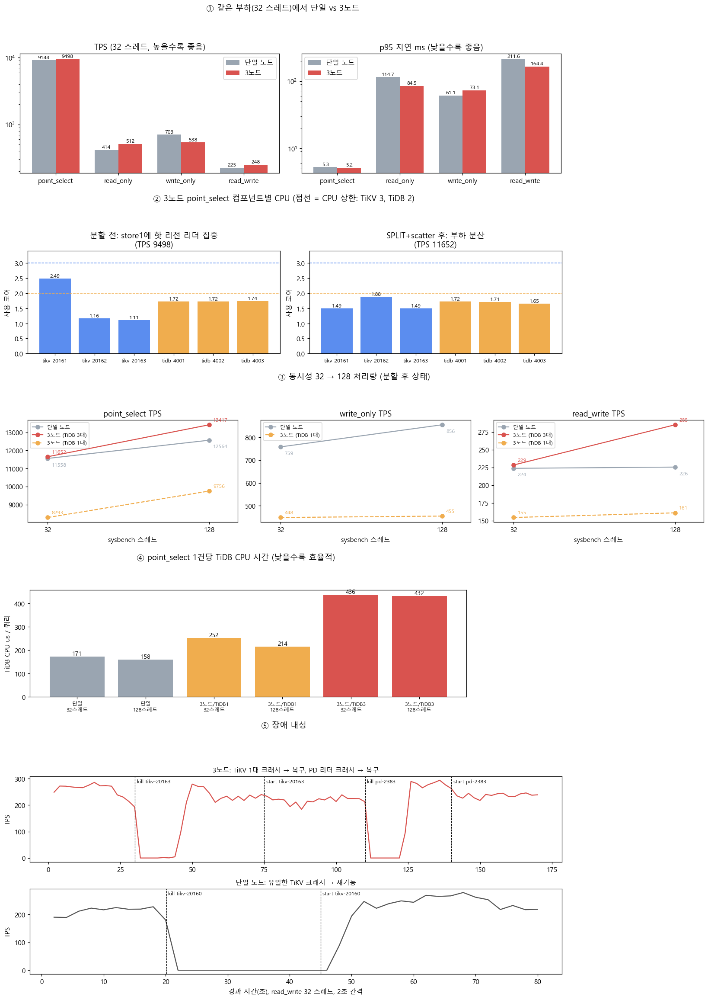

# TiDB 단일 노드 vs 3노드 비교 실험 (WSL2, tiup cluster)

WSL2 한 대에 TiDB 클러스터 두 개를 `tiup cluster`로 띄우고 비교했다. 하나는 단일 노드 구성(PD 1 · TiKV 1 · TiDB 1)이고, 다른 하나는 3노드 구성(PD 3 · TiKV 3 · TiDB 3)이다.
측정 항목은 처리량, 지연, 컴포넌트별 CPU, 리전 핫스팟, 장애 내성이다.

- 실험일: 2026-11-11
- 버전: TiDB / TiKV / PD **v8.5.8** (LTS), tiup v1.16.5, sysbench 1.1.0
- 결과 요약 차트: [`results/summary.png`](results/summary.png). 원시 수치가 포함된 리포트는 [`results/report.html`](results/report.html)이다. GitHub에서는 HTML이 렌더링되지 않으니 내려받아서 연다.



---

## 1. 한눈에 보는 결론

1. **읽기 지연은 노드 수와 무관하다.** 리더 하나가 읽기를 처리한다. 같은 부하에서 point_select는 단일 11,558 TPS, 3노드 11,652 TPS였고 p95는 둘 다 4.49ms였다.
2. **쓰기는 Raft 복제 비용을 그대로 낸다.** TiDB 자원을 같게 맞추면 write_only가 **41~47% 느리다** (759 → 448 TPS). 100만 행 적재도 40초에서 65초가 걸렸다.
3. **작은 테이블은 리전 1개라서 리더가 한 노드에 몰린다.** PD는 리더 *개수*를 맞추지만 *부하*는 맞추지 못한다. `SPLIT TABLE`과 scatter를 적용하자 TiKV CPU가 평탄해졌다.
4. **가용성 차이가 가장 결정적이다.** 3노드는 TiKV 1대가 죽어도 약 14초 뒤 *그 노드 없이* 회복했고, 클라이언트 에러는 0건이었다. 단일 노드는 TiKV가 다시 뜰 때까지 TPS가 0이었다.
5. **이 호스트에서는 3배 자원이 3배 처리량이 되지 않았다.** TiDB CPU 상한과 하이브리드 CPU(P/E 코어)의 영향이다. 단일 호스트로 시뮬레이션한 데서 오는 한계이고, 아래 [5. 분석](#5-분석)에 근거를 정리했다.

---

## 2. 환경

| 항목 | 값 |
|---|---|
| 호스트 CPU | Intel Core Ultra 9 185H (P코어 6개/12스레드 + E코어 8 + LP E코어 2 = 22 스레드). WSL에는 `11 cores × 2 threads`로 보인다 |
| WSL | WSL2, Oracle Linux 9.5, kernel 5.15.167.4-microsoft-standard-WSL2 |
| 메모리 / 디스크 | 31GB (+ swap 8GB) / ext4 (WSL 가상 디스크 1대를 모든 노드가 공유) |
| init / cgroup | systemd 사용(`/etc/wsl.conf`의 `[boot] systemd=true`), cgroup v1 하이브리드(+ unified) |
| 배포 도구 | tiup v1.16.5, `tiup cluster` v1.16.5 |
| DB | TiDB / TiKV / PD v8.5.8 (Go 1.25.12), Prometheus / Grafana 포함 |
| 벤치 | sysbench 1.1.0 (libmariadb), 10 테이블 × 100,000 행 (약 230MB) |
| 리포트 | Python 3.9 + matplotlib 3.9 + Pillow |

### 노드 하나의 사양 (systemd `resource_control`)

3노드를 그냥 한 호스트에 띄우면 세 노드가 22개 코어를 나눠 쓴다. 그러면 "서버 1대 vs 서버 3대" 비교가 되지 않는다.
그래서 노드 하나의 사양을 고정했다. 단일 노드는 서버 1대, 3노드는 같은 사양 서버 3대를 흉내 낸다.

| 컴포넌트 | CPU 상한 | 메모리 상한 | 비고 |
|---|---:|---:|---|
| TiKV | 300% (3코어) | 4G | `storage.block-cache.capacity: 1GB` |
| TiDB | 200% (2코어) | 2G | TiDB가 cgroup을 감지해 `maxprocs=2`로 설정됨 (로그 확인) |
| PD | 100% (1코어) | 1G | |
| **노드 합계** | **6코어** | **7G** | 3노드 = 18코어 / 21G |

### 포트

| | 단일 (`tidb-single`) | 3노드 (`tidb-3node`) |
|---|---|---|
| TiDB | 4000 (status 10080) | 4001 / 4002 / 4003 (status 10081~10083) |
| PD client/peer | 2379 / 2380 | 2381/2382, 2383/2384, 2385/2386 |
| TiKV / status | 20160 / 20180 | 20161~20163 / 20181~20183 (label `host=node1~3`) |
| Prometheus / Grafana | 9091 / 3001 | 9092 / 3002 |
| node_exporter / blackbox / ng-monitoring | 9100 / 9115 / 12020 | 9101 / 9116 / 12021 |
| 복제본 수 | `max-replicas: 1` | `max-replicas: 3`, `location-labels: [host]` |

Grafana 3000번은 다른 실험(도커 Grafana)과 겹치지 않도록 비워 뒀다. 토폴로지 원본은 [`topology/single.yaml`](topology/single.yaml)과 [`topology/3node.yaml`](topology/3node.yaml)이다.

---

## 3. 구축 방법

### 3-0. 사전 조건
- WSL2에서 systemd가 켜져 있어야 한다. `tiup cluster`는 컴포넌트를 systemd 유닛으로 띄운다.
- `sshd`가 떠 있어야 한다. `tiup cluster`는 localhost에도 SSH로 배포한다.
- `mysql` 클라이언트와 sysbench가 필요하다.

### 3-1. tiup 설치
```bash
curl --proto '=https' --tlsv1.2 -sSf https://tiup-mirrors.pingcap.com/install.sh | sh
source ~/.bash_profile
tiup cluster --version        # cluster 컴포넌트 설치 확인
```

### 3-2. localhost SSH 키 인증 + sshd 세션 수
```bash
# root -> 127.0.0.1 키 인증 (tiup이 이 키로 접속해 tidb 계정과 유닛을 만든다)
ssh-keygen -t rsa -b 4096 -N '' -f ~/.ssh/id_rsa
cat ~/.ssh/id_rsa.pub >> ~/.ssh/authorized_keys && chmod 600 ~/.ssh/authorized_keys

# 한 호스트에 인스턴스가 많으면 SSH 세션이 모자란다 (공식 문서 권고: 20)
echo 'MaxSessions 20' > /etc/ssh/sshd_config.d/99-tiup-lab.conf
sshd -t && systemctl reload sshd
ssh -o BatchMode=yes root@127.0.0.1 'echo SSH_OK'   # reload 직후엔 1~2초 기다린다
```

### 3-3. 환경 점검 (보기만 한다)
```bash
tiup cluster check topology/single.yaml --user root -i ~/.ssh/id_rsa
```
WSL에서는 THP, swappiness, SELinux, irqbalance, numactl, limits 항목이 `Fail`로 나온다([`results/env/check-single.txt`](results/env/check-single.txt)).
모두 운영 권고 사항이고 실습을 막지는 않는다. nofile은 tiup이 만드는 유닛에 `LimitNOFILE=1000000`으로 들어간다.
`--apply`는 시스템 전체 설정을 바꾸므로 쓰지 않았다.

### 3-4. 배포와 기동
```bash
tiup cluster deploy tidb-single v8.5.8 topology/single.yaml --user root -i ~/.ssh/id_rsa --yes
tiup cluster deploy tidb-3node  v8.5.8 topology/3node.yaml  --user root -i ~/.ssh/id_rsa --yes
tiup cluster start tidb-single
tiup cluster start tidb-3node      # --init을 안 주면 root 비밀번호가 비어 있다 (로컬 실습용)
```

### 3-5. 확인
```bash
tiup cluster display tidb-3node
mysql -h127.0.0.1 -P4001 -uroot -e 'SELECT tidb_version()\G'
curl -s http://127.0.0.1:2381/pd/api/v1/config/replicate            # max-replicas / location-labels
curl -s http://127.0.0.1:2381/pd/api/v1/stores                      # 스토어 라벨, 리더/리전 수
systemctl show tikv-20161 -p CPUQuotaPerSecUSec -p MemoryLimit      # 자원 제한 적용 확인
```
- TiDB Dashboard는 `display` 결과에서 `UI`가 붙은 PD에 있다. 단일은 `http://127.0.0.1:2379/dashboard`, 3노드는 `http://127.0.0.1:2383/dashboard`였다.
- Grafana는 `:3001`과 `:3002`이고, 계정은 admin / admin이다.

### 3-6. 정리
```bash
tiup cluster destroy tidb-single --yes
tiup cluster destroy tidb-3node  --yes
rm /etc/ssh/sshd_config.d/99-tiup-lab.conf && systemctl reload sshd
```

---

## 4. 실험 방법

### 스크립트

| 파일 | 하는 일 |
|---|---|
| [`scripts/bench.py`](scripts/bench.py) | sysbench를 실행하고 TPS, QPS, 지연을 기록한다. **systemd 유닛별 CPU 사용 코어 수와 CPUQuota throttling 횟수**도 함께 `results/bench.jsonl`에 남긴다 |
| [`scripts/split.sh`](scripts/split.sh) | 테이블마다 레코드와 보조 인덱스 `k_N`을 리전 3개로 `SPLIT`하고 scatter한다. 끝나면 store별 리더 수를 출력한다 |
| [`scripts/fault.py`](scripts/fault.py) | read_write 부하 중에 TiKV나 PD 리더를 **SIGKILL**하고 다시 살린다. TPS 타임라인을 2초 간격으로 기록한다 |
| [`scripts/make_report.py`](scripts/make_report.py) | `bench.jsonl`과 `fault-*.json`으로 `report.html`과 `summary.png`를 만든다 |

#### CPU 측정 방식
이 WSL은 cgroup v1에서 `cpu`와 `cpuacct`가 별도 계층이다. 그래서 `cpuacct`로는 서비스 단위 사용량이 잡히지 않는다.
대신 아래 두 값을 벤치 전후로 차분했다.
- 사용량: `/sys/fs/cgroup/unified/system.slice/<unit>.service/cpu.stat`의 `usage_usec`
- 스로틀링: `/sys/fs/cgroup/cpu/system.slice/<unit>.service/cpu.stat`의 `nr_throttled`

호스트 전체 CPU 사용률은 `/proc/stat`으로 계산했다.

### 실행 순서
측정 중에는 **반대쪽 클러스터를 내렸다**. 3노드는 18코어를 쓰기 때문에 둘을 동시에 띄우면 서로 간섭한다.

```bash
# (1) 기준선: 적재 + 워밍업 30초 + 4개 워크로드 x 60초, 32 스레드  (tag=base)
tiup cluster stop tidb-3node --yes
python3 scripts/bench.py single 32 60
tiup cluster stop tidb-single --yes && tiup cluster start tidb-3node
python3 scripts/bench.py 3node 32 60

# (2) 고동시성 + 핫스팟 해소
python3 scripts/bench.py 3node 128 45 --no-prepare --no-warmup --tag presplit --workloads oltp_point_select,oltp_read_write
bash scripts/split.sh 4001
python3 scripts/bench.py 3node 32 45 --no-prepare --no-warmup --tag split --threads-list 32,128 \
        --workloads oltp_point_select,oltp_read_write

# (3) 장애 내성 (3노드: TiKV node3 크래시 -> 복구 -> PD 리더 크래시 -> 복구)
python3 scripts/fault.py 3node

# (4) 단일 노드도 같은 절차 (presplit 128 -> split -> 32/128 -> 장애)
python3 scripts/bench.py single 128 45 --no-prepare --tag presplit --workloads oltp_point_select,oltp_read_write
bash scripts/split.sh 4000
python3 scripts/bench.py single 32 45 --no-prepare --no-warmup --tag split --threads-list 32,128 \
        --workloads oltp_point_select,oltp_write_only,oltp_read_write
python3 scripts/fault.py single

# (5) 3노드를 TiDB 1대(4001)로만 사용 -> TiDB 자원을 단일과 맞춰 복제 비용만 분리
python3 scripts/bench.py 3node-1tidb 32 45 --no-prepare --tag split --threads-list 32,128 \
        --workloads oltp_point_select,oltp_write_only,oltp_read_write

# (6) 리포트
/usr/bin/python3 scripts/make_report.py
```
sysbench 경로는 환경변수 `SYSBENCH`로 지정한다. 없으면 PATH에서 찾는다. 공통 옵션은 `--rand-type=uniform`과 `--mysql-ssl=off`다.

---

## 5. 결과

### 5-1. 같은 부하(32 스레드)에서 비교, 적재 직후 기준선 (`tag=base`)

| 워크로드 | 단일 TPS | 3노드 TPS | 차이 | 단일 p95(ms) | 3노드 p95(ms) | 단일 사용 코어 | 3노드 사용 코어 |
|---|---:|---:|---:|---:|---:|---:|---:|
| point_select | 9,144 | 9,498 | +4% | 5.28 | 5.18 | 4.33 | 10.4 |
| read_only | 414 | 512 | +24% | 114.72 | 84.47 | 4.13 | 10.98 |
| write_only | 703 | 538 | **-23%** | 61.08 | 73.13 | 4.58 | 9.29 |
| read_write | 225 | 248 | +10% | 211.6 | 164.45 | 4.75 | 11.58 |

단일 노드는 모든 워크로드에서 **TiDB가 2코어 상한에 붙어 있었다**(1.85~1.99코어, throttling 최대 381회).

### 5-2. 분할 후 상태에서 동시성 32 → 128 (`tag=split`)

| 워크로드 | 스레드 | 단일 | 3노드 (TiDB 3대) | 3노드 (TiDB 1대) |
|---|---:|---:|---:|---:|
| point_select | 32 | 11,558 TPS / p95 4.49ms | 11,652 TPS / p95 4.49ms | 8,293 TPS / p95 6.43ms |
| point_select | 128 | 12,564 TPS / p95 17.32ms | 13,417 TPS / p95 17.63ms | 9,756 TPS / p95 23.1ms |
| write_only | 32 | 759 TPS / p95 56.84ms | - | 448 TPS / p95 92.42ms |
| write_only | 128 | 856 TPS / p95 244.38ms | - | 455 TPS / p95 493.24ms |
| read_write | 32 | 224 TPS / p95 207.82ms | 229 TPS / p95 176.73ms | 155 TPS / p95 287.38ms |
| read_write | 128 | 226 TPS / p95 802.05ms | 285 TPS / p95 682.06ms | 161 TPS / p95 1069.86ms |

데이터 적재(prepare, 100만 행, 10 스레드)는 단일 **40.2초**, 3노드 **65.4초**(+63%)가 걸렸다.

### 5-3. 리전 핫스팟 (3노드, point_select 32 스레드)

| 상태 | TPS | TiKV CPU (store1 / 2 / 3) | TiKV throttling | sbtest 리더 분포 |
|---|---:|---|---|---|
| 적재 직후 | 9,498 | **2.49** / 1.16 / 1.11 코어 | 26 / 0 / 0 | 레코드 리전 리더 10개 중 **6개가 store1** (sbtest 전체 27 / 6 / 7) |
| SPLIT + scatter 후 | 11,652 | 1.49 / 1.88 / 1.49 코어 | 0 / 0 / 0 | 레코드 9 / 12 / 9 |

이 시점에 전체 리더 수는 38 / 28 / 29로 고르게 보였다. PD의 balance-leader는 *개수*를 맞추고, 부하가 몰린 리전이 어디에 있는지는 보지 않는다.
상세 분포는 [`results/env/3node-leaders-before-split.txt`](results/env/3node-leaders-before-split.txt)와 [`3node-split.txt`](results/env/3node-split.txt)에 있다.

### 5-4. 장애 내성 (read_write 32 스레드, 2초 간격)

| 시나리오 | 주입 | 처리 중단 | 클라이언트 에러 | 이후 |
|---|---|---|---:|---|
| 3노드: TiKV node3 크래시 | t=30s SIGKILL, t=75s 재기동 | **약 14초** (t=32~44 TPS ≈ 0) | 0 | 노드가 죽은 채로 자동 회복. 2대로 장애 전의 약 88% 유지 (270 → 239 TPS) |
| 3노드: PD 리더 크래시 | t=110s SIGKILL, t=140s 재기동 | **약 12초** (t=112~122 TPS 0) | 0 | 새 PD 리더가 선출되며 회복 |
| 단일: 유일한 TiKV 크래시 | t=20s SIGKILL, t=45s 재기동 | **약 26초, 재기동할 때까지 계속** | 0 | 재기동한 뒤에야 회복 |

- 장애 구간 p95는 3노드 약 15초, 단일 약 27초까지 올랐다. 에러가 0건인 이유는 TiDB가 backoff하며 재시도했기 때문이다. 그 대신 요청이 그만큼 대기했다.
- 죽었던 TiKV를 다시 띄운 뒤에도 리더가 바로 돌아오지 않았다. 30초 뒤에도 리더 수는 79 / 69 / **7**이었다. 클러스터 전체를 재기동하자 49 / 49 / 57이 됐다([`results/env/3node-leader-recovery.txt`](results/env/3node-leader-recovery.txt)).

### 5-5. 같은 일에 드는 TiDB CPU (point_select, 분할 후)

| 구성 | 32 스레드 | 128 스레드 |
|---|---:|---:|
| 단일 (TiDB 1대) | 171 µs/쿼리 | 158 µs/쿼리 |
| 3노드, TiDB 1대 사용 | 252 µs/쿼리 | 214 µs/쿼리 |
| 3노드, TiDB 3대 사용 | 436 µs/쿼리 | 432 µs/쿼리 |

---

## 6. 분석

**① 읽기**
- 같은 부하에서는 복제본 수가 읽기 지연을 바꾸지 않았다. 리더가 lease read로 혼자 응답하기 때문이다.
- 기준선(5-1)에서 read_only와 read_write가 3노드에서 더 빨랐던 이유는 3노드의 TiDB가 3대(6코어)였기 때문이다. 단일 노드는 TiDB 2코어가 병목이었다.

**② 쓰기**
- TiDB 예산을 1대로 맞추면(5-2의 오른쪽 열) 복제 비용만 남는다. write_only가 32 스레드에서 -41%, 128 스레드에서 -47%였다.
- 커밋마다 과반(2/3) 복제가 완료돼야 하고 세 TiKV가 모두 apply한다. 그래서 TiKV CPU 합이 2.6코어에서 5.7코어로 늘었다.
- 이 실험에서는 세 TiKV가 **같은 가상 디스크**에 fsync한다. 그래서 실제 서버 3대보다 쓰기 손해가 크게 나왔을 것이다.

**③ 핫스팟**
- sysbench 테이블은 20~30MB라 레코드 리전이 1개다. 리더 위치가 곧 부하 위치가 된다.
- 분할하자 TiKV CPU가 평탄해지고 store1의 throttling이 사라졌다.
- 다만 같은 시점에 **단일 노드도 TPS가 +26% 올랐다**. 분할하지 않은 단일 노드도 올랐으니, 3노드의 TPS 개선(+23%)을 분할 효과라고 볼 근거가 없다. 기준선이 적재 직후(컴팩션 진행 중)라 그 영향이 섞였을 가능성이 크다. 분할 효과의 근거는 CPU 분포 변화로 한정한다.

**④ 3배 자원인데 처리량은 +7~26%**
- 128 스레드에서 3노드의 TiDB 3대가 모두 2코어 상한에 붙었다. 쿼리당 TiDB CPU는 158µs에서 432µs로 2.7배가 됐다.
- 기각한 가설 1 — GOMAXPROCS: TiDB 로그에 `set the maxprocs quota=2`가 있었고, `go_sched_gomaxprocs_threads`도 2였다.
- 기각한 가설 2 — 리전 에러 재시도: 수 분 동안 `tidb_tikvclient_region_err_total{type="not_leader"}`가 약 100건이었다. 무시할 만한 수준이다.
- 가장 유력한 원인은 **호스트 CPU**다. 185H는 P코어 6개(12스레드)와 E코어 10개로 이뤄진 하이브리드다. 단일 노드는 바쁜 스레드가 5개 안팎이라 P코어 안에서 돈다. 3노드는 12~15개라 E코어와 HT 형제 스레드까지 쓰게 되고, 같은 일에도 CPU 시간이 늘어난다.
- 실제 서버 여러 대로 나누면 사라지는 손해이므로 TiDB 자체 특성으로 보면 안 된다.
- 3노드에서 TiDB 1대만 쓴 경우(252µs)도 단일(171µs)보다 높았다. 스토어가 3개로 나뉘면 TiDB → TiKV 요청 배치가 작아지는 영향도 있을 것으로 보이는데, 검증하지는 않았다.

**⑤ 가용성**
- 3노드는 노드 1대 장애를 약 15초 안에 자동으로 흡수했다. 단일 노드는 장애 시간이 곧 서비스 중단 시간이었다.
- 처리량 차이보다 이 차이가 3노드를 쓰는 이유다.

**⑥ 운영 포인트**
- 크래시에서 복구한 노드에는 리더가 천천히 돌아온다. 리더가 한쪽에 몰린 동안에는 그 노드들이 핫스팟이 된다.
- 계획된 재시작은 `tiup cluster restart -N`이나 upgrade 경로로 한다. 이 경로는 리더를 먼저 다른 노드로 옮긴다(evict-leader).

---

## 7. 시행착오 / 주의사항

- **sysbench 보조 인덱스 이름은 `k_N`이다.** `sbtest2`의 인덱스는 `k_2`다. 처음에 `k_1`로 일괄 SPLIT했다가 `sbtest2`에서 에러가 났다. mysql CLI는 첫 에러에서 배치를 멈추므로 분할이 거의 되지 않았다. 그 상태에서 측정한 결과는 버렸다.
- **적재 직후 측정은 기준선으로 쓰지 않는다.** 위 ③처럼 나중의 변화가 받을 몫을 왜곡한다. 적재 후 충분히 기다리거나 워밍업을 길게 준다.
- **cgroup v1에서 cpu와 cpuacct가 분리돼 있다.** 서비스별 CPU는 unified 계층의 `cpu.stat`에서 읽는다.
- **SIGKILL만 보내면 systemd가 15초 뒤 자동으로 재기동한다**(`Restart=always`). 크래시를 재현하려면 `systemctl kill --signal=SIGKILL` 뒤에 `systemctl stop`을 함께 보낸다.
- **sshd reload 직후 1~2초 동안은 `Connection refused`가 난다.** SIGHUP으로 리스너가 재시작되기 때문이다.
- tiup 매니페스트의 `Warn: invalid signature ... not enough signatures (0)`은 다운로드에 영향이 없었다.
- 두 클러스터를 동시에 띄워 두면 유휴 상태에서도 메모리를 약 14GB 쓴다.

## 8. 한계

- 모든 노드가 물리 CPU, 디스크, 메모리 대역폭을 공유한다. CPU 상한은 CFS quota로 걸었기 때문에 VM이나 물리 서버와 달리 throttling에 따른 꼬리 지연이 생긴다.
- 데이터가 230MB라 전부 block cache에 들어간다. 디스크 I/O 특성은 거의 반영되지 않는다.
- 각 조건을 45~60초씩 **한 번만** 측정했다. ±10% 안팎의 차이는 오차일 수 있다.

## 9. 다음에 해볼 것

- TiDB Dashboard의 **Key Visualizer**로 5-3의 핫스팟을 시각적으로 확인하기
- **Follower Read**(`tidb_replica_read`)로 놀고 있는 팔로워에 읽기 분산하기
- TiKV를 4대로 **scale-out**해 리전 재배치를 관찰하고, `max-store-down-time` 이후 복제본 자동 보충 확인하기
- 데이터를 키워(수십 GB) 디스크 I/O가 개입하는 조건에서 다시 비교하기
- async commit / 1PC, 낙관적·비관적 트랜잭션에 따른 쓰기 지연 비교

---

## 디렉터리 구조

```
tidb-cluster/
├── README.md
├── topology/
│   ├── single.yaml          # PD1 / TiKV1 / TiDB1, max-replicas 1
│   └── 3node.yaml           # (PD+TiKV+TiDB) x 3, max-replicas 3
├── scripts/
│   ├── bench.py             # sysbench + 유닛별 CPU/throttling 수집
│   ├── split.sh             # SPLIT TABLE + scatter
│   ├── fault.py             # 장애 주입 + TPS 타임라인
│   ├── make_report.py       # report.html / summary.png 생성
│   └── findings.html        # 리포트 본문(분석) 조각
└── results/
    ├── bench.jsonl          # 모든 측정 (1줄 = 1회 실행)
    ├── fault-single.json    # 장애 타임라인
    ├── fault-3node.json
    ├── summary.png          # 요약 차트 5종
    ├── report.html          # 차트 + 분석 + 원시 표
    ├── raw/                 # sysbench 원본 출력, 실행 로그
    └── env/                 # tiup check 결과, 리더 분포, 분할 결과
```
